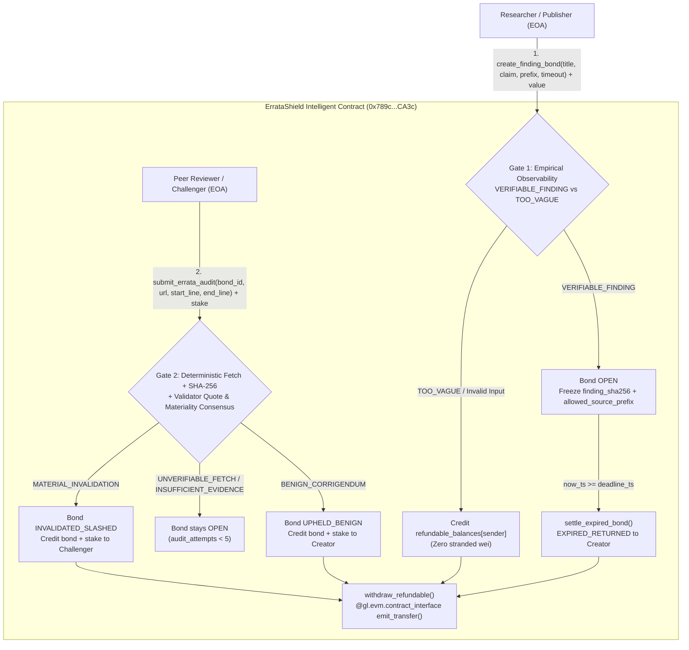

# Errata Shield

**Retraction-Aware Scientific & Mathematical Errata Materiality Escrow on GenLayer StudioNet**

`Errata Shield` is a two-gate Intelligent Contract protocol (`ErrataShield`) deployed on GenLayer StudioNet (`Chain ID 61999`) that distinguishes **material scientific retractions or proof invalidations** from **cosmetic typographical corrigenda** and **unrelated/adversarial excerpts** over immutable public archives.

- **Main Contract (`ErrataShield`)**: [`0x789cC30C52eb51B16B7092B1eaB73d73B15dCA3c`](https://explorer-studio.genlayer.com/address/0x789cC30C52eb51B16B7092B1eaB73d73B15dCA3c)
- **Probe Contract (`EvidenceProbe`)**: [`0xfCb0Ee3eDcEFDE1f979310602067083bC55Be1Ee`](https://explorer-studio.genlayer.com/address/0xfCb0Ee3eDcEFDE1f979310602067083bC55Be1Ee)
- **Network**: GenLayer StudioNet (`https://studio.genlayer.com/api`, Chain ID `61999`)

---

## Why Only GenLayer Can Do This

Traditional smart contracts and regex/diff oracles fail on scientific errata because **both** a fatal scientific retraction and a harmless spelling corrigendum edit the same publication record and contain words like *"error"*, *"correction"*, or *"updated"*:

- **Material Invalidation:** *"Over the following months, all scientists who tried to duplicate her results failed, and suspicion arose that Obokata's results were due to error or fraud."* $\to$ Core empirical claim is invalidated; creator bond is slashed to the challenger.
- **Benign Corrigendum:** *"In Remark 1.2.7: 'proof this' should be 'proof of this'"* or *"the first successful proof was released in 1994 and formally published in 1995"* $\to$ Finding stands; challenger stake is awarded to the bond creator.

`Errata Shield` pairs GenLayer LLM validator consensus (`gl.vm.run_nondet_unsafe`) with deterministic Python evidence slicing, SHA-256 verification, verbatim substring quote enforcement, and native EVM value transfers.

---

## Architecture



### Built-In Safety & Consensus Invariants
1. **Line-1 Payable Deposit Capture:** Every `@gl.public.write.payable` method (`create_finding_bond`, `submit_errata_audit`) captures `gl.message.value` immediately and credits `refundable_balances[sender]` on any validation failure or `TOO_VAGUE` Gate-1 rejection.
2. **Strict Verdict ↔ Reason Compatibility Matrix (`VERDICT_COMPATIBLE_REASONS`):** Every verdict (`MATERIAL_INVALIDATION`, `BENIGN_CORRIGENDUM`, `INSUFFICIENT_EVIDENCE`, `UNVERIFIABLE_FETCH`) is deterministically constrained to its valid reason codes in `leader_fn`, `validator_fn`, and pre-storage assertions.
3. **Retry Preservation on Non-Conclusive Outcomes:** `UNVERIFIABLE_FETCH` (e.g., empty slice or transient HTTP error) refunds the challenger stake without slashing and preserves `status == "OPEN"` up to `MAX_AUDIT_ATTEMPTS = 5`.
4. **Bound Immutable Evidence Namespace:** Accepts only `https://en.wikipedia.org/w/api.php?action=parse&oldid=...`, commit-pinned `https://raw.githubusercontent.com/<owner>/<repo>/<40-hex-sha>/...`, or `https://web.archive.org/web/<14-digit>id_/...` matching the bond's frozen `allowed_source_prefix`, while blocking self-hosted fixtures.
5. **Fail-Closed GenVM Clock & Native Transfers:** Uses only `gl.message_raw["datetime"]` (`TRUSTED_TIME_UNAVAILABLE` if missing) with zero `time_offset` backdoors, and executes real native withdrawals via `_EoaRecipient(gl.message.sender_address).emit_transfer(value=u256(amount))`.

---

## Live StudioNet Proof Ledger (`deploy/proof.json`)

All **16 StudioNet transactions** below are `FINALIZED` (`MAJORITY_AGREE` / `SUCCESS`) on [`0x789cC30C52eb51B16B7092B1eaB73d73B15dCA3c`](https://explorer-studio.genlayer.com/address/0x789cC30C52eb51B16B7092B1eaB73d73B15dCA3c):

| Step / Case | Outcome | Transaction Hash |
| :--- | :--- | :--- |
| `EvidenceProbe` Deploy | `0xfCb0Ee...Be1Ee` | [`0xfe6c1d...`](https://explorer-studio.genlayer.com/tx/0xfe6c1d3d8021eb89c3689974fcf8923c25841a0482c3b08978216ce312bce82b) |
| `EvidenceProbe.probe_url_slice` | `SHA-256 Verified` | [`0x23edc7...`](https://explorer-studio.genlayer.com/tx/0x23edc7a9d000d51751015c37ef73dbce2cf7613a0db9788c0f2995cb5164cf60) |
| `ErrataShield` Deploy | `0x789cC3...dCA3c` | [`0x92741d...`](https://explorer-studio.genlayer.com/tx/0x92741da3f5bd6fb20dc286e866ac2bd33877a3eb425f23670293eed7c84b061d) |
| **Case 1** — STAP Cells (2014 Nature Retraction) | `MATERIAL_INVALIDATION` | [`0x42d946...`](https://explorer-studio.genlayer.com/tx/0x42d946940db70c990c9fa576ac9a98d8f09e5bbbf28e3b7ded73879202959cc4) |
| **Case 2** — Fermat's Last Theorem (1995 Proof) | `BENIGN_CORRIGENDUM` | [`0xa87bc6...`](https://explorer-studio.genlayer.com/tx/0xa87bc69666ca337ec4bb1cf1479e7ff23e5ff1338e50e7b875f20b1ff93acfe5) |
| **Case 3** — Subjective Literary Claim | `TOO_VAGUE` (Refunded) | [`0x57e221...`](https://explorer-studio.genlayer.com/tx/0x57e221a5cf4c0d134230ddc6b4b50dbf706ab7f5e88e71794a895f1bd35b630a) |
| **Case 4** — Unrelated Photosynthesis Excerpt | `INSUFFICIENT_EVIDENCE` (`OPEN`) | [`0x601c5e...`](https://explorer-studio.genlayer.com/tx/0x601c5e2a4dd31057e6541973fe22178853845008a99cf53f77598e889e594c88) |
| **Case 5** — Empty Line Slice (`9000..9020`) | `UNVERIFIABLE_FETCH` (`OPEN`) | [`0xa18fa4...`](https://explorer-studio.genlayer.com/tx/0xa18fa47e3748f0ed5091cc10956c6f71ff25c2c917c4d092b754acfaa8fdefc7) |
| **Case 6** — Disallowed Mutable/Self-Hosted URL | `REJECTED_INVALID` (Refunded) | [`0xb8df4a...`](https://explorer-studio.genlayer.com/tx/0xb8df4a7ef6a0b97fa48622e9dbb89829fa49e4970db3089753696d5826ea2ee5) |
| **Case 7** — Short-Window Bond Expiry | `EXPIRED_RETURNED` | [`0x9f5544...`](https://explorer-studio.genlayer.com/tx/0x9f554412c6a19fde9e49dcd1b10143ff598af6d3453f77103e7b389cd31feb0f) |
| Creator `withdraw_refundable()` (`340 wei`) | `WITHDRAWN` (EOA Transfer) | [`0xcaa3a5...`](https://explorer-studio.genlayer.com/tx/0xcaa3a55b499d3a96f58bc91c7266db1360e4cc6fa045aa95f7807608f14be794) |
| Challenger `withdraw_refundable()` (`160 wei`) | `WITHDRAWN` (EOA Transfer) | [`0x5ab5f1...`](https://explorer-studio.genlayer.com/tx/0x5ab5f16fe7bd06130628baab38c3cc5ff1178b64e26280c067a06ca651187f90) |

---

## Quickstart & Verification

```bash
# 1. Run Intelligent Contract unit tests (11 tests)
python -m pytest tests/test_errata_shield.py -v

# 2. Re-verify all 16 finalized StudioNet transactions and on-chain state against deploy/proof.json
python deploy/verify_proof.py

# 3. Run frontend tests, lint, and production build
npm --prefix frontend install
npm --prefix frontend run test
npm --prefix frontend run lint
npm --prefix frontend run build
```

---

## Honest Limitations

- **Windowed Excerpt Scope:** `submit_errata_audit` evaluates bounded line slices (`1..120` lines, `<= 3000` chars) so validators reach deterministic SHA-256 agreement without hitting context limits; multi-section proofs spanning distant chapters require separate targeted audits.
- **Public Archive Dependency:** External hosts (`en.wikipedia.org`, `raw.githubusercontent.com`, `web.archive.org`) must be reachable by StudioNet validators at audit time; transient non-200 responses safely resolve to `UNVERIFIABLE_FETCH` and refund the challenger stake.
- **Demo Denominations:** Live StudioNet proof transactions use `100 wei` bonds and `20 wei` challenger stakes to demonstrate exact arithmetic and native `emit_transfer` payouts cleanly on testnet.
